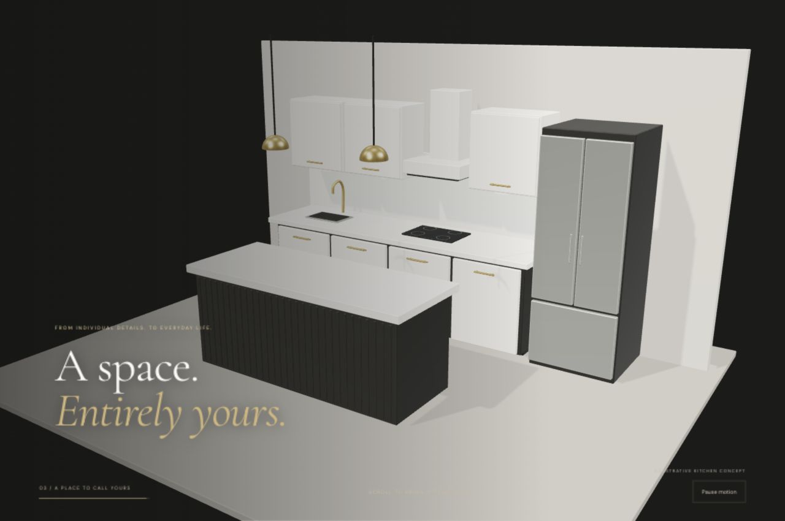

# Royalty Cabinets — React concept

An interactive website concept for Royalty Cabinets, with an animated kitchen reveal on desktop and mobile.

[Open the live preview](https://isaacochoabII.github.io/royalty-cabinets-concept/)



## Start and build

Requires Node.js 22.12+ (or Node 20.19+). Use the included pnpm lockfile.

```sh
pnpm install
pnpm dev --port 8090
pnpm build
pnpm preview --port 8091
```

The HTML file must be served through the development server or from the built `dist/` directory. Opening the source HTML directly as a file will not run the React application.

## Experience

- Original logo is preserved as the supplied PNG.
- Main dark background is #1B1B1A; white/ivory and muted gold support it.
- Desktop: three large cabinet fronts glide into their final positions as the camera reveals a complete kitchen. The room emerges through lighting/material color, without translucent overlapping geometry.
- The scene includes base and upper cabinets, an island, countertop, sink and faucet, cooktop, hood, refrigerator and pendant lights.
- GSAP ScrollTrigger drives a reversible, smoothed timeline. React Three Fiber renders Three.js with physically based materials and environment lighting.
- Canvas uses demand rendering and is invalidated during the timeline. Device pixel ratio is capped at 1.5 and shadow maps at 1024px.
- Under 900px, a lightweight 3D profile preserves the same panel-to-kitchen story: 1× pixel ratio, simple box geometry, no shadow maps, no environment-map generation, fewer island details, a portrait camera, and a shorter 280svh scroll sequence. Reduced-motion users receive the normal-scrolling photo hero without importing the 3D module.
- If the desktop component fails, the photo fallback remains available.
- Visible Pause/Resume control stops the animated scene while allowing normal page scrolling.

## Important scope

The kitchen is an original procedural concept scene, not a scan or manufacturer-approved model of Royalty products. It demonstrates the art direction, layout and choreography. It is not a photorealistic product rendering. A production finish can replace the meshes with an approved optimized GLB without changing the narrative structure.

Images and factual copy are based on royaltycabinets.ca. Emotional headlines and the three-step narrative are proposed copy. No lead form is connected; the estimate CTA links to the existing estimates page.

## Key files

- `src/main.jsx`: page, mobile/reduced-motion gate and fallbacks.
- `src/DesktopHero.jsx`: responsive 3D renderer, lighting, meshes and scroll timeline.
- `src/styles.css`: layout, palette and responsive presentation.
- `public/assets/`: existing website photography and unchanged logo.

## Checks

Production build completed. Browser checks covered the desktop WebGL scene and scroll progress, Pause/Resume, narrow layouts at 390px and 320px, and a 1× canvas and the animated kitchen on mobile. Physical-device performance remains a production validation task.

## Publishing

Every push to `main` builds and publishes the site through GitHub Actions to GitHub Pages. The workflow uses the included lockfile. Enable **Settings → Pages → Source → GitHub Actions**. The production base path is configured for this repository; local development remains at `/`.
